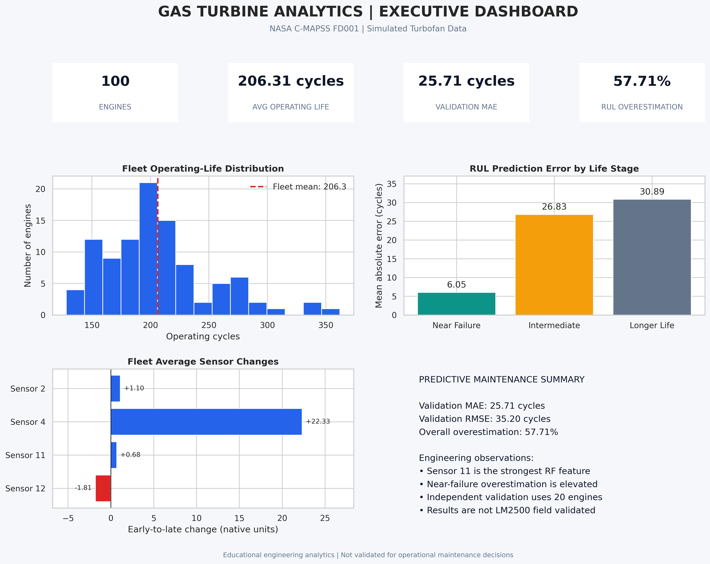
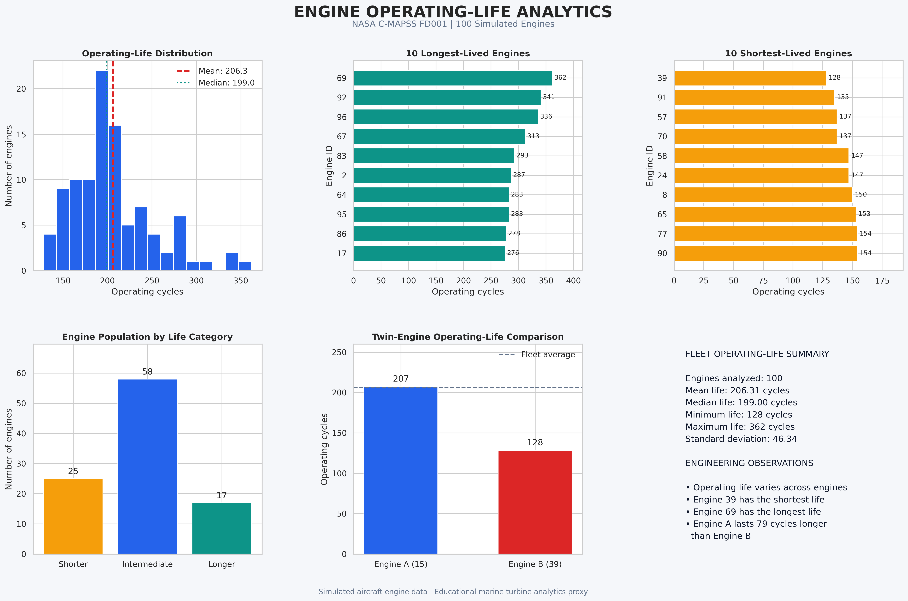
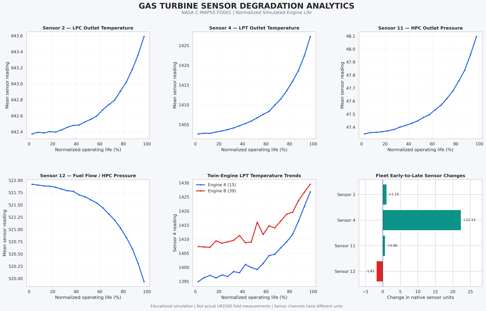
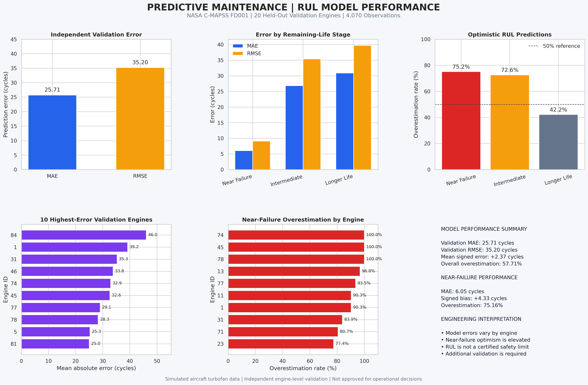
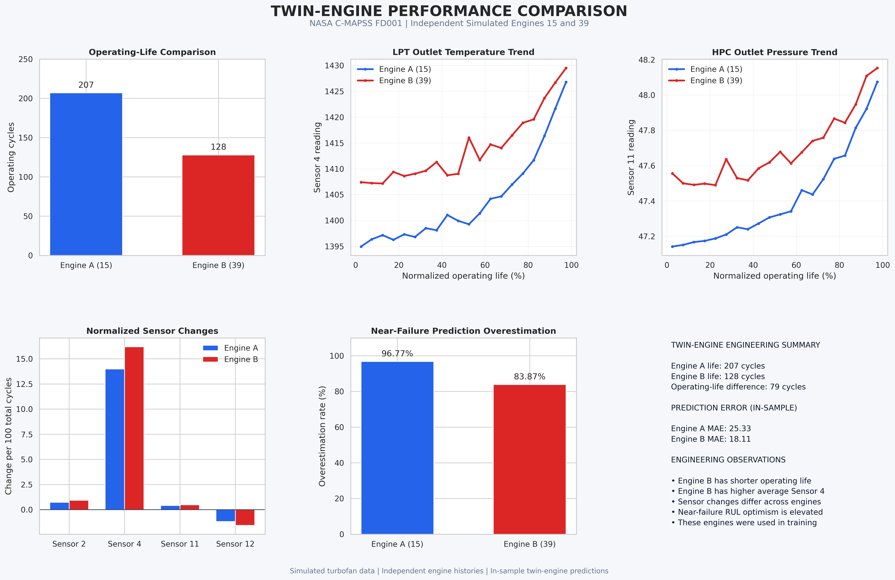

# Gas Turbine Performance and Predictive Maintenance Analytics

## Marine Gas Turbine Engineering Case Study | NASA C-MAPSS FD001

An end-to-end engineering analytics project exploring gas turbine
condition monitoring, operating-life variability, remaining useful
life (RUL) prediction, and maintenance decision support.

**Important data distinction:** This project uses the NASA C-MAPSS
FD001 dataset of simulated aircraft turbofan engines. It is an
educational proxy for investigating concepts relevant to marine
gas turbine systems, including the GE LM2500. It does not use
actual LM2500 operational data and is not an approved maintenance
or diagnostic system.

## Project Objectives

- Analyze engine operating-life variability across a simulated fleet.
- Examine temperature and pressure sensor trends.
- Compare two independent simulated engine histories.
- Develop and evaluate a remaining useful life prediction model.
- Use SQL to investigate fleet behavior and prediction errors.
- Produce engineering dashboards and maintenance recommendations.
- Document limitations, risks, and validation requirements.

## Dataset

**Source:** NASA C-MAPSS FD001

| Dataset characteristic | Value |
|---|---:|
| Training engines | 100 |
| Training observations | 20,631 |
| Sensor channels | 21 |
| Operating settings | 3 |
| Minimum engine life | 128 cycles |
| Mean engine life | 206.31 cycles |
| Maximum engine life | 362 cycles |

Engine histories are simulated run-to-failure trajectories.
The operating cycles are dataset cycles, not verified LM2500
service hours or maintenance intervals.

## Tools and Methods

- Python
- pandas and NumPy
- scikit-learn Random Forest regression
- SQLite and SQL
- Matplotlib
- Google Colab
- CSV-based engineering reporting
- Engine-level training and validation separation

## Predictive Maintenance Model

A Random Forest regression model was trained using sensor
measurements and operating settings.

The evaluation used 80 training engines and 20 held-out
validation engines, with no engine overlap.

| Validation metric | Result |
|---|---:|
| Validation observations | 4,070 |
| Mean absolute error | 25.71 cycles |
| Root mean squared error | 35.20 cycles |
| R-squared | 0.7126 |
| Mean signed error | +2.37 cycles |
| Near-failure RUL overestimation rate | 75.16% |

Near failure refers to observations with actual RUL between
0 and 30 cycles.

The near-failure overestimation rate is an important model
limitation. The model should not be used to set operational
maintenance intervals.

## Engineering Findings

### 1. Fleet Operating-Life Variation

The simulated fleet exhibited substantial operating-life
variation, ranging from 128 to 362 cycles.

### 2. Sensor Degradation Trends

Fleet-average early-to-late changes included:

- Sensor 2: +1.1021 native units
- Sensor 4: +22.3255 native units
- Sensor 11: +0.6811 native units
- Sensor 12: -1.8089 native units

The channels have different physical units and should not
be compared as equivalent degradation magnitudes.

These retrospective associations do not establish causation.

### 3. Twin-Engine Comparison

Two independent simulated histories were selected:

| Metric | Engine A | Engine B |
|---|---:|---:|
| NASA engine ID | 15 | 39 |
| Operating life | 207 cycles | 128 cycles |
| Mean Sensor 4 | 1404.03 | 1414.03 |

Engine A operated 79 cycles longer.

These engines are not physically coupled marine engines.
Their previously calculated model predictions are in-sample,
not independent validation results.

### 4. Predictive Maintenance Risk

Near-failure predictions frequently overestimated actual
remaining useful life. This motivates additional uncertainty
analysis and conservative engineering review before any
potential operational application.

## Engineering Dashboards

### Executive Fleet Dashboard

### Operating Life Dashboard

### Sensor Degradation Dashboard

### Predictive Maintenance Dashboard

### Twin-Engine Comparison Dashboard

## SQL Analysis

The project includes 14 SQL query files supporting fleet
statistics, sensor trends, twin-engine comparisons, and
RUL prediction-error analysis.

Supporting documentation:

- [SQL Engineering Report](sql_engineering_report.md)
- [SQL Validation Report](sql_validation_report.md)

## Maintenance Recommendations

Five proposed engineering-development priorities:

1. Sensor condition monitoring.
2. RUL prediction uncertainty assessment.
3. Equipment-level reliability analysis.
4. Engineer-reviewed inspection prioritization.
5. Predictive model improvement and validation.

These are research recommendations, not approved maintenance
procedures or inspection thresholds.

See the
[Final Engineering Recommendations Report](LM2500_Final_Engineering_Recommendations.md).

## Engineering Risk Assessment

Six preliminary risk areas were evaluated:

- Dataset representativeness
- Optimistic RUL predictions
- Sensor data quality
- Model generalization and leakage
- Unvalidated maintenance decisions
- Model drift and monitoring

Risk scores are illustrative planning judgments rather than
measured failure probabilities or certified safety ratings.

See the
[Engineering Risk Assessment](engineering_risk_assessment.md).

## Implementation Roadmap

1. Data qualification
2. Sensor and feature validation
3. Independent model evaluation
4. Engineering review
5. Advisory pilot
6. Operational authorization

## Project Limitations

- NASA FD001 is simulated aircraft turbofan data.
- No actual GE LM2500 operational records were analyzed.
- Sensor trends are retrospective.
- Twin-engine comparisons are illustrative.
- The selected twin-engine model predictions are in-sample.
- No operational alarm thresholds were validated.
- The model is not approved for real maintenance decisions.

## Engineering Conclusion

This project demonstrates an end-to-end workflow connecting
equipment sensor analysis, predictive modeling, SQL validation,
engineering visualization, and structured maintenance
recommendations.

Its primary contribution is a reproducible educational
analytics framework, not an operational LM2500 diagnostic
or maintenance decision system.

## Data Source

NASA Prognostics Center of Excellence:
Commercial Modular Aero-Propulsion System Simulation
(C-MAPSS), FD001 dataset.

## Reproducibility and Publication Status

The original analysis notebook, dependency manifest, engineering dashboards, SQL scripts, executive report, and engineering recommendations are included in this repository.

- [Validated Engineering Only Notebook](LM2500_Marine_Gas_Turbine_Engineering_Only.ipynb) — primary analysis notebook
- [Original Development Notebook](LM2500_Marine_Gas_Turbine_Analytics.ipynb) — retained for historical reference
- [Reproducibility Guide](REPRODUCIBILITY.md)
- [Python Dependencies](requirements.txt)
- [SQL Validation Report](sql_validation_report.md)

The SQL validation report documents passing database integrity and consistency checks.

The Engineering Only notebook was successfully executed in a fresh Google Colab runtime during project validation. Its 50 executable code cells were verified in the saved notebook, and the final portfolio ZIP passed integrity testing.

These checks do not constitute independent reproduction on another machine or validation using actual GE LM2500 operational data.

**Publication status:** Portfolio artifacts and the validated engineering notebook are available. Independent reproduction, dependency version pinning, and operational validation remain future work.
